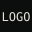
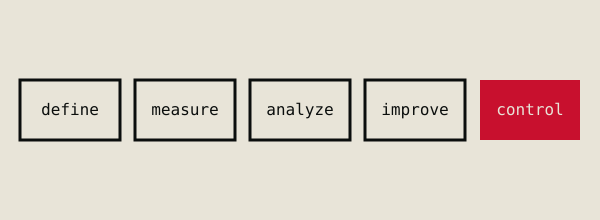

This post exists only on the preview branch, to show the new field-note features. A small
inline image  stays on the text line.

## a diagram with a caption

## a photo (grayscale treatment)

## an image with no caption

Click any framed figure to open it full size. Scroll down for the "written with" block and
the sources list. The /projects page shows "built with" on the real-time SPC card.
